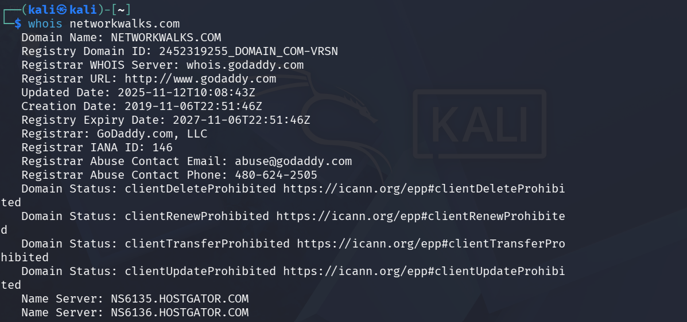
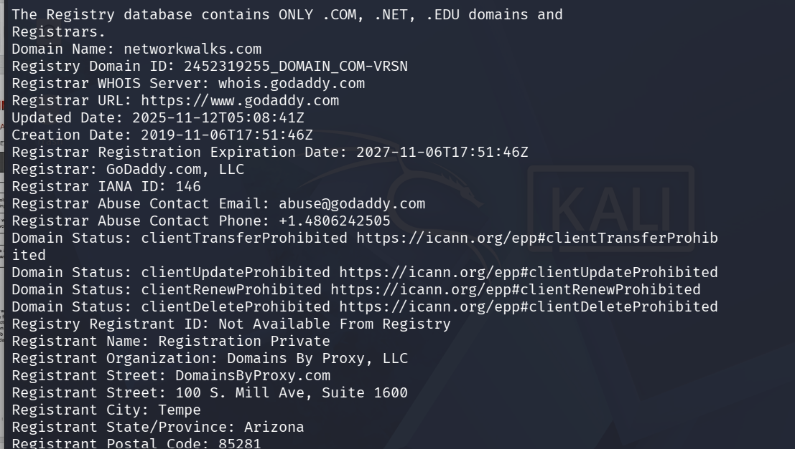
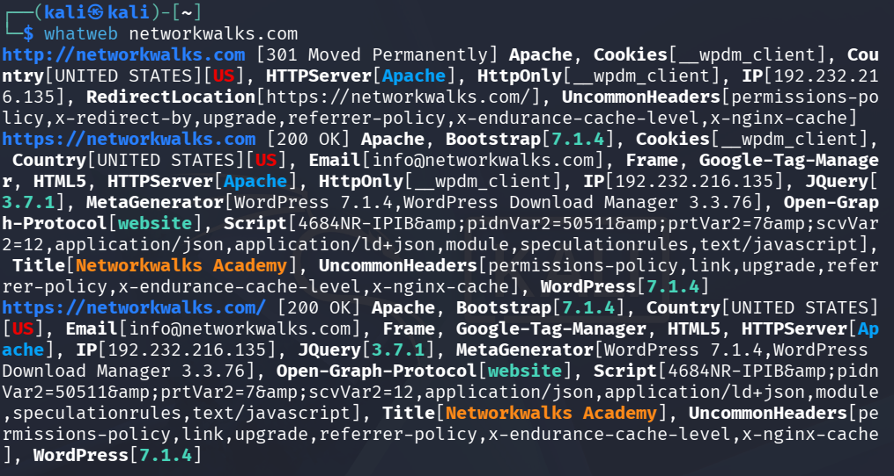
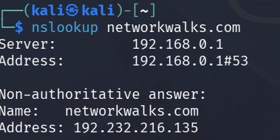
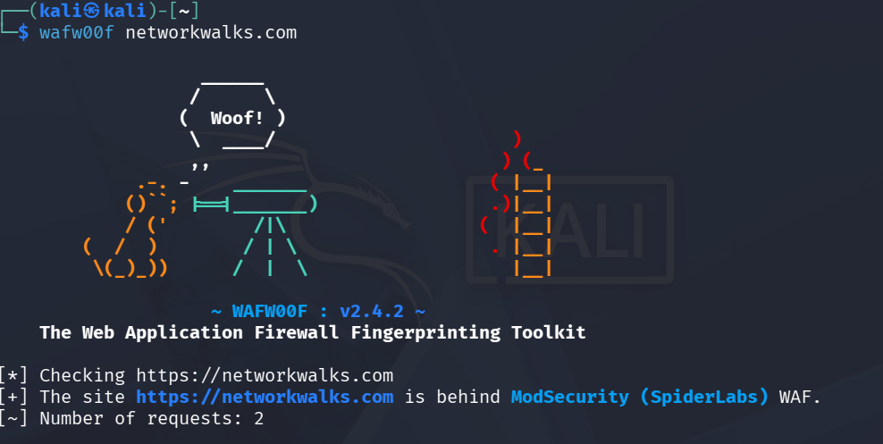
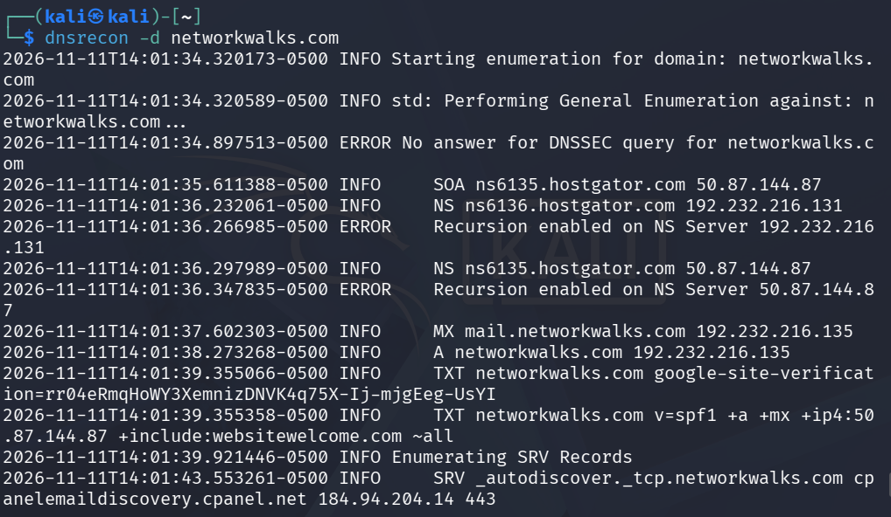
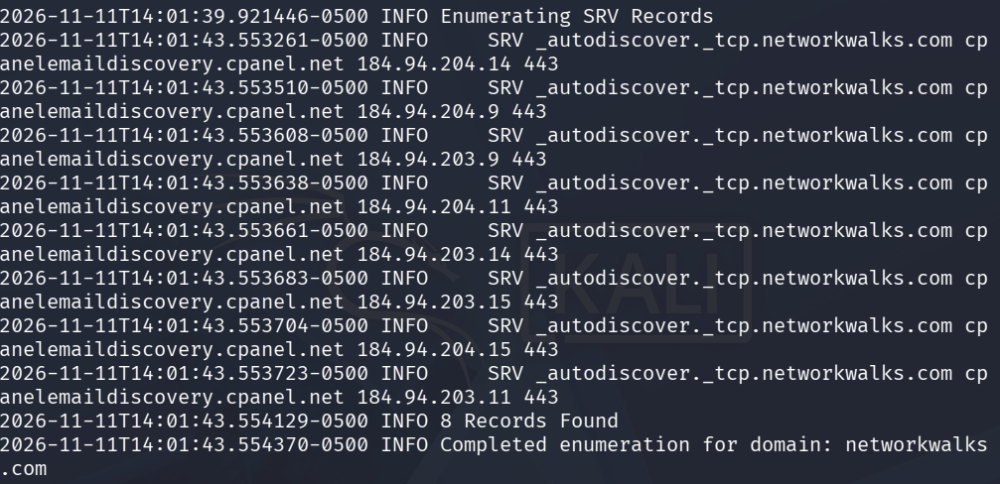

# 🛡️ Penetration Testing Report: Footprinting & Network Scanning

> **Engagement:** W2-PM-FINAL | Cybersecurity Program  
> **Client / Target:** Networkwalks & Local LAN Network  
> **Pentester:** Junayen Ansari (Cybersecurity Professional)  
> **Date:** 12 November 2026  
> **Status:** Phase 1 & 2 Complete (Phases 3–5 In Progress)

---

## 📋 Table of Contents
1. [Liability Disclaimer](#1-liability-disclaimer)
2. [Introduction](#2-introduction)
3. [Tools Used](#3-tools-used)
4. [Activities Performed](#4-activities-performed)
5. [Risk Analysis & Impact](#5-risk-analysis--impact)
6. [Recommendations](#6-recommendations)
7. [Conclusion](#7-conclusion)
8. [Evidence Collected](#8-evidence-collected)

---

## 1. Liability Disclaimer
> ⚠️ **Notice:** I have performed these activities only on systems & devices where I had secured written permission or the devices/systems that I own myself. All these materials are for education and research purposes only. Do not use anything from here to break the law. Misuse can lead to criminal charges, heavy fines, loss of your job, and a permanent record. In most countries, unauthorized access is a crime even when nothing is damaged.

---

## 2. Introduction
This report covers footprinting the `networkwalks.com` domain using multiple Kali Linux tools (W2-PM1) and scanning my own local network with Zenmap (W2-PM5). One module covers the footprinting phase and the other covers the scanning phase, showing how an attacker moves from gathering public information to mapping live hosts on a network as part of my ongoing internship program at Networkwalks.

All commands were run in Kali Linux (footprinting) and on a Windows PC with Zenmap installed (scanning). Every step below includes the exact command used, the result observed, evidence screenshots, and analysis from an attacker's perspective.

---

## 3. Tools Used

| Tool | Purpose |
| :--- | :--- |
| **Kali Linux & Windows** | Operating systems used for reconnaissance activities |
| **WHOIS** | Find domain registration details (owner, dates, name servers) |
| **WhatWeb** | Fingerprint web technologies (server, CMS, plugins, IP) |
| **Nslookup** | Resolve the domain name to its IP address using DNS |
| **Curl (`-I`)** | Read the HTTP response headers of the website |
| **Wafw00f** | Detect whether a Web Application Firewall protects the site |
| **DNSRecon** | Enumerate all DNS records (NS, MX, SPF, TXT, SRV) |
| **Zenmap (Nmap GUI)** | Scan the local subnet to find live hosts, IPs, and MAC addresses |

---

## 4. Activities Performed

### 4.1 Footprinting & Reconnaissance
I performed reconnaissance against the `networkwalks.com` domain using six Kali Linux tools:
* **WHOIS:** Obtained publicly available domain registration information and identified name servers (`NS6135.HOSTGATOR.COM`, `NS6136.HOSTGATOR.COM`).
* **WhatWeb:** Identified underlying web technologies, specifically WordPress (v7.0.4) and WP Download Manager (v3.3.58).
* **Nslookup:** Resolved the domain name to its target IP address (`192.232.216.135`).
* **Curl (`-I`):** Inspected HTTP response headers, revealing HTTP/2 status codes, server info, and the WordPress REST API endpoint (`/wp-json/`).
* **Wafw00f:** Detected that the website is protected behind **ModSecurity (SpiderLabs)** WAF.
* **DNSRecon:** Enumerated DNS records including NS, MX, SPF/TXT, and service records.

### 4.2 Network Scanning with Zenmap
For the second activity, I used Zenmap to perform network discovery on my local network (`10.0.0.0/24`) using a Ping Scan (`nmap -sn 10.0.0.0/24`) to identify active hosts, IP addresses, MAC addresses, and generated the network topology layout.

---

## 5. Risk Analysis / Impact

| # | Risk / Finding | Evidence / Observation | Potential Impact | Risk Level |
| :-: | :--- | :--- | :--- | :--- |
| **1** | Web technology info exposed | WhatWeb identified WordPress & WP Download Manager | Attackers may identify software requiring further security review | Medium |
| **2** | Server IP address identifiable | Nslookup resolved domain to `192.232.216.135` | Provides network location visibility of the web service | Low |
| **3** | HTTP technical info exposed | Curl returned headers and exposed `/wp-json/` | Assists technology fingerprinting and enumeration | Low |
| **4** | WAF technology identifiable | Wafw00f identified ModSecurity (SpiderLabs) | Reveals security architecture details | Low |
| **5** | DNS infrastructure exposed | DNSRecon identified DNS, mail, and service records | Helps build a broader infrastructure profile | Medium |
| **6** | Multiple live hosts visible | Zenmap identified active hosts on local subnet | Unexpected or unauthorized devices may be present on a network | Medium |

> *Risk Level Key: 🔴 Critical | 🟡 Medium | 🟢 Low*  
> *Note: These risks are observations from information-gathering exercises, not confirmed vulnerabilities.*

---

## 6. Recommendations
* **Review Public Exposures:** Regularly audit what web technologies, CMS versions, and plugins are publicly visible.
* **Keep Software Updated:** Patch CMS platforms, plugins, and web servers against current security advisories.
* **Harden HTTP Headers:** Review HTTP response headers to minimize exposure of unnecessary technical details.
* **Audit DNS Records:** Periodically check DNS records to ensure only required information is publicly published.
* **Maintain WAF Configuration:** Keep ModSecurity enabled and properly tuned to block automated scanning and naive attacks.
* **Internal Network Monitoring:** Periodically scan internal subnets, investigate unknown devices, and maintain up-to-date network diagrams.
* **Strict Authorization:** Ensure reconnaissance and scanning activities are strictly restricted to authorized scopes.

---

## 7. Conclusion
During Week 2 of my Cybersecurity & Ethical Hacking internship, practical exercises in footprinting and network scanning demonstrated how much intelligence an attacker can gather without direct exploitation. From DNS enumeration and WAF detection to local host discovery, thorough documentation and adherence to authorized scopes remain core pillars of professional security assessments.

---

## 8. Evidence Collected

* **WHOIS Output (Part 1):**  
  
* **WHOIS Output (Part 2):**  
  
* **WhatWeb Fingerprinting:**  
  
* **Nslookup Resolution:**  
  
* **Curl Header Inspection:**  
  
* **Wafw00f Detection:**  
  
* **DNSRecon Output (Part 1):**  
  
* **DNSRecon Output (Part 2):**  
  

---

👤 **Author:** Junayen Ansari (Cybersecurity Trainee)  
🔗 **LinkedIn:** [Junayen Ansari](www.linkedin.com/in/junayen-ansari-204674208)  
📌 **Program:** Cybersecurity Program at Networkwalks | Week 02
